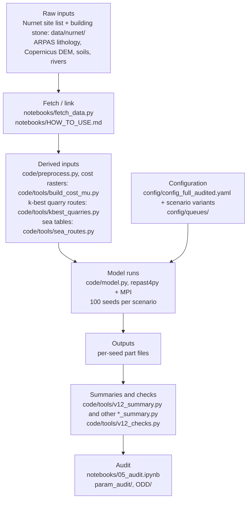

# Nuraghe construction: an agentic agent-based model

**Background.** This model is an implementation of the agentic agent-based modelling framework proposed by Altaweel and Forte (2026).

Reference: Altaweel, M. and Forte, M. (2026). Archeological theory and AI: the potential past through agentic systems. AI & Society. https://doi.org/10.1007/s00146-026-03287-0

An agent-based model (ABM) built to test archaeological ideas about **how nuraghi were built**: who quarried,
dressed, hauled and lifted the stone, how communities cooperated, formed alliances or relied on pre-existing
networks, and what each idea implies for labour and time. Bronze Age Sardinia (7,167 nuraghe sites) is the test
case; the method is the subject. Each community is an agent that plans its towers stage by stage, asks other
communities for help, learns from its own building and from trust built by reciprocity, and moves stone along
least-cost routes over the real terrain (and, in some scenarios, by sea). Literature-based scenarios set the
labour rates, block sizes, haul techniques, lifting methods, population and season length; every parameter is
traced to its source or labelled as an assumption (`param_audit/`).

The model is written in Python on **repast4py** (Collier, N. and Ozik, J. 2022. Distributed agent-based
simulation with Repast4Py. *Proceedings of the 2022 Winter Simulation Conference (WSC)*.
doi:[10.1109/WSC57314.2022.10015389](https://doi.org/10.1109/WSC57314.2022.10015389)) and MPI.

## How it works

- **Agents.** One community agent per nuraghe (7,167), with its residents, its work party and the towers it has to
  build (`code/alliance.py`; ODD section 2).
- **A season** (one tick: 90 working days of 8 hours, standing for one year). Each community works on its current
  tower as a chain of stage tasks: quarrying, dressing, hauling the blocks on sledges along least-cost routes from
  the chosen quarry face, and building (including lifting) (ODD sections 2-3).
- **Cooperation.** Communities ask others within 10 km for help (up to 3 requests); a request is accepted according
  to trust, which reciprocity raises or lowers. Each community learns which choices worked for it, imitates
  successful neighbours, and gains skill with experience (ODD sections 3-4). The 10 km help radius is the headline
  value; a sensitivity ran it at 5 and 15 km on the audited headline (`MOST_REALISTIC_AUDITED_LIT_R5_P10` /
  `_R15_P10`, `config/config_R5_audited.yaml` / `config_R15_audited.yaml`, ODD Appendix B).
- **Quarry face choice and the near-site rule (v14, kept in v15 and v16_final).** Each site has up to 5 candidate quarry faces (the k-best
  least-cost routes); at each tower it picks one by epsilon-greedy learning (exploration with epsilon = 0.1,
  otherwise the face with the best learned value) or by imitating a cheaper neighbour. From 5 November 2026 the code
  has a near-site rule (config key `quarry.near_site_fixed_face_m`, 1,000 m in the v15 and v16_final configs;
  absent or 0 = off): a site whose dry-ground route to its nearest (cheapest) face is at most 1,000 m always quarries
  from that face, with no exploration, value choice or imitation of the face (the other choices are unchanged).
  Sites farther away keep the choice among their faces. With the key off the v14 code reproduced the frozen code
  (ODD section 7.6; `code/CHANGES_V14_NEARFACE.md`).
- **Minimum haul (v15).** `transport.min_haul_flatm` is 15 m in the v15 configs (100 m in the audited configs): the
  haul of a site that sits on its outcrop, and the floor of every whole route (drag and walk back; relay legs have
  no minimum). It is a config value only (no code change; the sea tables, which apply it, are rebuilt per config;
  ODD section 7.5; `code/CHANGES_V15_HAUL15.md`). The v16_final configs keep it.
- **v16_final (5 November 2026; `code/` until 9 November 2026).** The on-outcrop test uses the stone set a site actually
  quarries (v15b). Four rules sit behind flags in a top-level `add4:` config block: L2 `bedrock_everywhere` (every
  site quarries at the bedrock rate) and L3 `load_per_tonne` (loading per tonne) are ON by default, L1
  `rails_cost_choice` and L4 `sea_priced_as_charged` OFF. The summary output adds the island-wide 95th percentile of
  site finish seasons and spread statistics across seeds; the relay leg-1 "nearer the quarry" candidate filter is
  removed; three fixes: D3 (a stage with no work creates no help request, walk, trust change or skill credit), D6
  (join mode prices each party at its own skill), D11 (the site's stone is the class of the face it hauls from). The
  run signature includes `CODE_VERSION` and the add4 settings (`code/CHANGES_V15B_OUTCROP.md`, `CHANGES_V16.md`,
  `CHANGES_V16_FINAL.md`, `code/METHODS.md`).
- **v17 (9 November 2026, the current `code/`).** The v16_final code with lift priced at the undiscounted rate (spec
  addendum k): lift, by every lift rule, is never discounted; the learning factor (1 - 0.15)^t and skill apply to
  quarrying, dressing and building only (ODD sections 7.7, 7.9, 7.12; `CODE_PROVENANCE.md`; new test
  `code/tests/test_v17_lift.py`; `CODE_VERSION` `2026-11-09-v17`, checksums `CODE_V17_SHA256SUMS`). No config
  changed. The results in the paper are being regenerated with v17: this code with the configs in
  `config/v16_final/`. The ODD describes v17 (ODD change log).
- **Phasing.** In the headline scenario the island is built in cohorts of 10% of the communities, one cohort after
  the other (`_P10`; ODD section 7).
- **What is measured.** Man-hours per site and stage, start and finish of every tower; per seed, island man-hours
  and island years (the time until the last tower is finished), over 100 seeds per scenario (ODD section 4.11).
- **v13 social switches.** Three opt-in mechanisms (`reputation`, `partner_choice`, `tie_imitation`), off by default and in the headline, used only by five v13 scenarios; with them off the v13 code reproduces the frozen code (ODD section 7.15; `CODE_PROVENANCE.md`). A rule key `reputation_rule` (`all`, the default, or `gentle`: only defectors' and ungrateful refusals cost standing) is used by three v13g scenarios (`config/config_v13g_*.yaml`); with the default the outputs and signatures of the v13 runs are unchanged. A further switch `trusted_nodist` (no distance penalty in the acceptance of help between reciprocal partners, after Kasper & Borgerhoff Mulder 2015, Fig. 2) is used by two v13kd scenarios (`config/config_v13k_*.yaml`; ODD section 7.16); with it absent the outputs and signatures of every earlier run are unchanged. These switches are in `code/` from v15 on (v15 = the v13 code + the near-site rule; kept in v16_final); the v14 code (5 November 2026, superseded) did not have them (`CODE_PROVENANCE.md`).
- **Parameters.** No parameter is calibrated: every value has an audited source (author, year, page) or is
  declared an assumption (`param_audit/`).

## Workflow



## Start here

| Model description | Replicate the results |
|---|---|
| [ODD/ODD.md](ODD/ODD.md) (PDF: [ODD/ODD.pdf](ODD/ODD.pdf)): the ODD protocol of the full audited model | [notebooks/](notebooks/): start with [notebooks/HOW_TO_USE.md](notebooks/HOW_TO_USE.md), then run `01_setup`, `02_inputs`, `03_scenarios`, `04_analysis_report`, `05_audit`, `06_sensitivity` in order, in Jupyter or Google Colab (v17 code, configuration `config/v16_final/config_full_audited.yaml`) |

Parameter audit and traceability: [param_audit/](param_audit/) (below).

### Replicate the results: quick start in Colab

1. Open [notebooks/README.md](notebooks/README.md) and use the "Open in Colab" links, 01 to 06 in order.
2. In the config cell of each notebook set `MOUNT_DRIVE = True` and the same Google Drive folders for `DATA_DIR`,
   `DERIVED_DIR` and `OUTPUTS_DIR` (each Colab notebook runs in its own runtime; values in
   [HOW_TO_USE.md](notebooks/HOW_TO_USE.md#run-in-google-colab)).
3. Run all cells. 01 installs OpenMPI and the pinned packages; 02 copies the Nurnet files from `data/nurnet/`,
   downloads every public input from its official source (`notebooks/fetch_data.py`) and gets the derived inputs;
   03 and 04 run and analyse scenarios; 05 is the step-by-step audit (code checksums, inputs, configuration, a fixed
   rerun, the headline numbers), each step with its expected result; 06 runs the sensitivity steps (A5 grid, Morris,
   Sobol) at demo size. The full-size sensitivity results are in `outputs/sensitivity/`, and the Sobol harnesses in
   `sensitivity/` (see [Sensitivity results](#sensitivity-results)).

The Nurnet files (site list and per-site building stone) are included in `data/nurnet/`; for the latest version and
source information contact Nurnet at nurnet.presidente@gmail.com.

### Data availability

- **Nurnet's data** (7,167 nuraghe sites with tower counts; building stone per site): included in this repository,
  `data/nurnet/` (`data/nurnet/README.txt`). For the latest version and source information contact Nurnet at
  nurnet.presidente@gmail.com.
- **Public layers** (ARPAS lithology, Copernicus DEM GLO-30, AGRIS soil map, RAS rivers): not redistributed here;
  `notebooks/fetch_data.py` downloads them from the official sources and rebuilds the files the model reads, and
  `notebooks/HOW_TO_USE.md` gives the same steps by hand. Each file is checked against the SHA-256 of the copy used
  for the runs (`notebooks/inputs_manifest.csv`); the files that cannot be byte-identical, and why, are listed there
  and in `data/README.md`.
- **Derived inputs** (haul tables, quarry routes, sea tables, ...): rebuilt from the raw inputs by
  `python notebooks/fetch_data.py --rebuild-derived` (about 30-45 min), or the prebuilt pack of the full audited run
  in the results package (DOI pending).
- **Results** of the full audited run (per-seed tables, part files, logs): results package, DOI pending.

## Sensitivity results

The sensitivity results of the final model (code v17, configuration `config/v16_final/config_full_audited.yaml`)
are in [`outputs/sensitivity/`](outputs/sensitivity/), as small island-level tables (no per-site data). It is the only
folder of the repository with model results. Each subfolder has a README with the factors, ranges, commands and dates.

| folder | what | status |
|---|---|---|
| `a5_alliance/` | alliance-model grid on `A5_full`: 27 cells (radius x learning ratio x track cost) + the `A0_alone` reference, 100 seeds each | complete |
| `sobol2/` | Sobol run 2 on the headline: 26 factors, Saltelli N = 512 (14,336 evaluations x 3 seeds) | design now; results with the final pass |
| `coop_sobol/` | cooperation-model Sobol: 11 factors x scenarios none / mixed / full, N = 512 (19,968 evaluations) | design now; results with the final pass |
| `morris/` | Morris screens (32-factor screen; physical 5-factor screen) | with the final pass |
| `feasibility/` | feasibility grid (pull x drag x tonnage) | with the final pass |

**Reading the tables.** All are CSV (`*.csv.gz`: gzip-compressed; `pandas.read_csv` reads both).

- *Inputs:* `design.csv(.gz)` (one row per evaluation: `eval_id`, `base_row`, `block` = the Saltelli block A, AB_<factor>
  or B, the uniform sample `u_<factor>` and the factor values), `factors.csv` (name, config key, distribution,
  range, reason), `problem.json` (the SALib problem and the sampling settings).
- *Per-run tables:* `runs.csv.gz` (`sobol2`) has one row per model run (evaluation x seed); `per_eval.csv.gz` one row per
  evaluation (the mean of its seeds for `sobol2`; one seed for `coop_sobol`), with `status` and the outputs (for
  example `island_years`, `island_mh` = island man-hours, `mh_transport_share`; `island_total_mh`, `island_days_max`
  and `median_site_total_mh_TWR1..7` = median over the sites with 1-7 towers). `a5_alliance/` has its own
  `cells.csv`, `island_by_seed.csv` and `sensitivity.csv` (described in its README).
- *Index tables* (`indices.csv`, and `indices_N256.csv` on the first half of the design as a convergence check):
  one row per (`scenario`,) `output` and `factor`; `N` = base rows used; `S1` = first-order index (the share of the
  output's variance due to the factor alone); `ST` = total-order index (alone and in interaction with the others);
  `S1_conf` / `ST_conf` = half-width of the 95% bootstrap confidence interval (1,000 resamples), `*_lo` / `*_hi` =
  the interval's ends. Morris tables give `mu_star` (mean absolute elementary effect) with its 95% interval.
- `MANIFEST.csv`: every exported file with its size, number of rows, SHA-256 and source run; check a file with
  `sha256sum FILE` against the `sha256` column.

**Regenerating them.** The Sobol harnesses are in [`sensitivity/`](sensitivity/) (the scripts that ran, with the
code variant of Sobol run 2 as a patch on `code/`; commands, runtime and memory in each README). They write the
run tables and indices into their own folder; `python outputs/sensitivity/export.py --project <folder>` turns them
into the tables above (it recomputes the indices with SALib 1.6.0 and checks them against the run's own analysis).
The A5 grid runs from `code/` (`outputs/sensitivity/a5_alliance/README.md`); `notebooks/06_sensitivity.ipynb` runs
every design at demo size.

## Repository layout

```
code/            the model and its tools: the code of the full audited run + the v13 social switches + the near-site face
                 rule + the v15b / v16 changes + the v17 lift rule (v17; CODE_PROVENANCE.md)
  model.py         entry point (baseline, cooperation, literature, alliance and pre-network scenarios)
  alliance.py      adaptive alliances / MOST_REALISTIC; lit.py, sea.py, phasing.py, pre_networks.py, census_v12.py
  preprocess.py    haul tables (least-cost quarry -> site); nbcommon.py config loader + Dijkstra
  tools/ tests/    derived-input builders, post hoc analyses, verification
  full_chain.sh    the serialized chain that ran the full audited queue
config/          config_full_audited.yaml (+ 84 variants, tost_configs/), v16_final/ (the v16_final run configs),
                 v15_haul15/, v14_nearface/ (the superseded v15 and v14 rerun configs, kept as a record), queues/,
                 sea_expect/, check_sea_meta.py
data/            data/nurnet/ (Nurnet's data, included); the other inputs are fetched (data/README.md; data/derived/README.md)
notebooks/       01-06: setup, inputs (fetch_data.py), scenarios, analysis, audit, sensitivity; HOW_TO_USE.md; Jupyter or Colab
param_audit/     parameter audit and traceability (public-safe copies)
tools_extra/     build_slope.py, build_dem.py, build_lithology.py, build_rivers.py (input builders; not in the frozen snapshot)
outputs/         everything a run writes (NOT committed, except sensitivity/ (the sensitivity results) and reference/ and
                 summary/ for the audit)
sensitivity/     harnesses of the Sobol runs (sobol2/, coop_sobol/; see Sensitivity results)
CODE_SHA256SUMS  checksums of the run's code snapshot (CODE_V13_/V14_/V15_/V16_FINAL_/V17_SHA256SUMS: v13, v14, v15, v16_final, v17);  CODE_PROVENANCE.md  what differs and why
```

## Requirements / Installation

Linux or macOS (Windows: WSL2 with Ubuntu), Python 3.12 or later for exact (byte-identical) reproduction, because from 3.12 Python's built-in float `sum()` uses compensated summation and the model sums floats with it; the tested environment is Python 3.13.5.
On Python 3.10-3.11 the model runs and results agree except for last-digit differences.

| what | version (minimum in `code/requirements.txt`; tested in `notebooks/requirements-colab.txt`) |
|---|---|
| MPI with compiler wrappers | OpenMPI or MPICH. Ubuntu / Debian / Colab: `sudo apt-get install -y openmpi-bin libopenmpi-dev`; macOS: `brew install open-mpi`; conda: `conda install -c conda-forge openmpi mpi4py` |
| repast4py | >= 1.1.6; tested 1.3.1 (Collier & Ozik 2022, above; install guide https://repast.github.io/repast4py.site/) |
| mpi4py | >= 3.1; tested 4.1.2 |
| numpy / numba / pandas | >= 1.24 / >= 0.58 / >= 2.0; tested 2.5.4 / 0.68.0 / 3.0.6 |
| geopandas / pyogrio / rasterio | >= 0.14 / >= 0.7 / >= 1.3; tested 1.2.0 / 0.13.0 / 1.5.2 (the wheels include GDAL, tested 3.12.2; no system GDAL needed) |
| pyyaml | >= 6.0; tested 6.0.3 |
| also pinned for the tools and notebooks | scipy 1.18.1, shapely 2.2.0, pyproj 3.8.0, matplotlib 3.11.2, networkx 3.7, reportlab 5.1.0, SALib 1.6.0 and dependencies (35 pins) |

1. Install MPI (above).
2. Install the Python packages; repast4py and mpi4py compile against MPI:
   ```
   CC=mpicc CXX=mpicxx python -m pip install -r notebooks/requirements-colab.txt     # exact tested versions
   CC=mpicxx CXX=mpicxx python -m pip install -r code/requirements.txt              # or: minimum versions
   ```
   `torch` is not pinned: repast4py imports it, the model never uses it.
3. Get the input data: `python notebooks/fetch_data.py` (or by hand: `notebooks/HOW_TO_USE.md`); set `data_dir:` in
   the config you use to the **absolute** path of the data folder (the configs in `config/` hold a placeholder).

Resources (measured on the 8 GB machine of the runs): one 100-seed run of the headline scenario on 6 MPI ranks takes
about 6 minutes and peaks at about 6 GB (proportional set size 5.9 GB; resident 7.6 GB; largest rank 2.8 GB); the
derived-input rebuild peaks at about 2.5 GB (one process at a time). Disk: about 0.5 GB of raw inputs, 0.75 GB of
derived inputs, about 0.25 GB of part files per 100-seed scenario.

`code/full_chain.sh` (the full queue) also needs `flock` and Linux cgroup v2 (it reads
`/sys/fs/cgroup/memory.events` to stop on an out-of-memory kill).

Environment variables used by the scripts (only where a path was hard-wired in the project):

| Variable | Meaning |
|---|---|
| `PYTHON` | the Python interpreter of the environment above (shell scripts; default `python3`) |
| `NURAGHE_RUN_DIR` | the run folder of `code/full_chain.sh` (below) |
| `NURAGHE_PROJECT` | the project folder of the earlier runs, for the historical chain/test scripts and some post hoc tools (`code/*_chain.sh`, `code/tests/*.sh`, `tools/v11_*`, `tools/v12_*`, ...); not needed for the model itself |
| `NURAGHE_DATA` | the data folder, for `tools/v12_checks.py` (default `data`) |

## Rebuild the derived inputs

The model reads cached derived inputs (haul tables, k-best quarry routes, sea tables, food catchments, drag-cost
rasters per friction). Download them from the results package or rebuild them with the commands in
`data/derived/README.md` (in order: cost and slope rasters, `preprocess.py`, haul tables per friction,
`tools/kbest_quarries.py`, `tools/kbest_mu038.py`, `tools/wl_inputs.py`, `tools/sea_routes.py`,
`tools/food_capacity.py`, `tools/census_bichrome.py`); `python notebooks/fetch_data.py --rebuild-derived` runs them
all in order (about 30-45 min with the hybrid stone rule, peak about 2.5 GB).

The stone rule of the full audited configuration is `hybrid`: the recorded building stone of each site where it is
known, else the nearest outcrop of the 7 permitted classes. That per-site file is **Nurnet's data (site building
stone)**, included as `data/nurnet/nurnet_site_building_stone.csv` (`fetch_data.py` copies it to
`stone/nid_materiale_prod.csv` under the data folder). `stone_rule: stones7` ignores it (results then differ).

## Run one scenario

From `code/`, with a configuration whose `data_dir` and `cache_dir` point at the inputs:

```
cd code
mpirun -n 6 $PYTHON model.py /path/to/run/config_full_audited.yaml --seeds 1-100 --no-shapefile \
       --alliance MOST_REALISTIC_AUDITED_LIT_P10
```

`MOST_REALISTIC_AUDITED_LIT_P10` is the headline scenario of the full audited run (6 ranks; about 6 min and up to
~8 GB on the machine that ran it). Other families: `--scenario NAME` (cooperation), `--lit NAME` (literature),
`--alliance NAME` (alliances, MOST_REALISTIC and its variants), `--pre NAME` (pre-existing networks); no flag =
baseline. `--sites UID1,UID2,...` (e.g. the contents of `code/sites300_real.txt`) runs a subset. Runs are resumable:
finished seeds are kept as part files under `cache_dir/runs/<signature>/` (the signature hashes every parameter and
the site list) and skipped on restart. Field meanings and the model rules: `code/METHODS.md`. The notebooks
(`notebooks/`) wrap the same commands.

## Run the full audited queue

The full audited run is `config/queues/queue_full.tsv` (78 entries, priority 1) followed by
`config/queues/queue_full_p23.tsv` (370 entries, priorities 2-3): seeds 1-100 everywhere, one entry at a time,
each scenario on its named config. `code/full_chain.sh` runs it serially and is resumable (a finished entry leaves
`outputs/logs/q_<label>.ok`). It expects a run folder laid out as below:

```
REPO=/path/to/Repast_Nuraghe; RUN=/path/to/run_full_audited; DATA=/path/to/data; PYTHON=/path/to/python
mkdir -p $RUN/outputs/logs && ln -s $REPO/code $RUN/code
cp $REPO/config/config_full_audited*.yaml $REPO/config/check_sea_meta.py $RUN/ && cp -r $REPO/config/tost_configs $RUN/
sed -i "s|^data_dir: .*|data_dir: $DATA|" $RUN/config_full_audited*.yaml $RUN/tost_configs/*.yaml
for q in queue_full.tsv queue_full_p23.tsv; do
  sed -e "s|@RUN_DIR@|$RUN|g" -e "s|@PYTHON@|$PYTHON|g" $REPO/config/queues/$q > $RUN/$q; done
# base cache: download or rebuild into $RUN/outputs/cache (data/derived/README.md); sea/ must be an EMPTY real
# folder (the first queue entry, SEA_TABLES, rebuilds it)
# own caches of the variant entries: link every base-cache entry except the part each entry rebuilds
for d in $(grep -h '^  cache_dir:' $RUN/config_full_audited_*.yaml | awk '{print $2}' | sort -u | grep -vx outputs/cache); do
  D=$RUN/$d; mkdir -p $D/sea
  [ -f $REPO/config/sea_expect/$(basename $d).json ] && cp $REPO/config/sea_expect/$(basename $d).json $D/sea_expect.json
  if [ $(basename $d) = cache_alt_stones7 ]; then mkdir -p $D/alliance $D/haul; keep="census cost_mu food stones4"
  else keep=$(ls $RUN/outputs/cache | grep -vx -e sea -e runs -e sea_expect.json); fi
  for b in $keep; do [ -e $D/$b ] || ln -s $RUN/outputs/cache/$b $D/$b; done
done
cd $RUN && NURAGHE_RUN_DIR=$RUN PYTHON=$PYTHON CUTOFF="2099-12-31 23:59" \
  nohup bash code/full_chain.sh > outputs/logs/chain_full.out 2>&1 &
```

`CUTOFF` stops the chain from starting an entry whose estimated end falls after that time (the run used a fixed
deadline; dropped entries are listed in `outputs/logs/dropped.tsv`). Progress lines go to `$RUN/FULL_NOTES.md`.
The queue was estimated at about 34 hours of wall time on the 8 GB machine that ran it.

### The v16_final run configs (run with the current code, every scenario)

`config/queues/queue_v16_final.tsv` holds the 432 model entries of the v15 queue, in the same order, each on its
config in `config/v16_final/` (the v15 config of the same name; `output_dir` points to `v16_final/outputs` and
`cache_dir` to its own `v16_final/outputs/caches/<config name>`, relative to the config; the two loading sensitivity
rows `alt_load033` / `alt_load05` keep their own loading with `add4: {load_per_tonne: false}`). The queue has no
preparation entries: each config's cache holds the prepared tables of the cache that the v15 config of the same name
uses, built with the current `code/`. Its `preprocess.py` has the v15b on-outcrop fix, so a base cache built with an
earlier code differs in one row (site NID9220200, `on_outcrop`): rebuild the base cache with `code/`, run the `cmd`
entries of `queue_v15.tsv` with `code/` (sea tables of every cache, `cache_alt_stones7` inputs), then link every entry
of that cache except `runs/` into `$RUN/v16_final/outputs/caches/<config name>/` and give each its own empty `runs/`.
`code/v16f_chain.sh` runs the queue like `full_chain.sh`: copy `config/v16_final/*.yaml` to `$RUN/v16_final/configs/`,
write the queue to `$RUN/v16_final/queue_v16_final.tsv` with the same `sed`, link `$RUN/code_v16_final` to
`$REPO/code`, and start `bash code/v16f_chain.sh` from `$RUN` with `NURAGHE_RUN_DIR=$RUN`. The run signature
includes `CODE_VERSION` and the effective add4 settings, so no part file of an earlier version is reused. Run with
the current `code/` (v17), this queue gives the v17 results (signature `CODE_VERSION` `2026-11-09-v17`); the v16_final
code itself is `code/` before the v17 update (git history).

### The v15 rerun (superseded, kept as a record)

The v15 rerun (minimum haul 15 m + near-site rule, every scenario) is superseded by v16_final; its configs and queue
are kept as a record. It runs with the v15 code (`code/` before the v16_final update, git history), which also
holds `v15_chain.sh`. `config/queues/queue_v15.tsv` holds every entry of the full audited queue, the v13 social entries and the two
help-radius entries, each on its config in `config/v15_haul15/` (the audited or v13 config with
`transport.min_haul_flatm: 15` and `quarry.near_site_fixed_face_m: 1000`; the 200 / 210 / 300 m minimum-haul
sensitivity configs keep their value; `cache_dir`/`output_dir` point to `v15_haul15/outputs`, relative to the
config), plus a 10 m minimum-haul sensitivity of the headline (`config_full_audited_haul10.yaml`). Its first
entries (`kind` = cmd) rebuild the sea tables of every cache at the new minimum and the own inputs of
`cache_alt_stones7`. `v15_chain.sh` runs it like `full_chain.sh`. In the run folder above: copy
`config/v15_haul15/*.yaml` to `$RUN/v15_haul15/configs/`, write the queue to `$RUN/v15_haul15/queue_v15.tsv` with the
same `sed`, link `$RUN/code_v15_haul15` to a checkout of the v15 `code/`, give `$RUN/v15_haul15/outputs/cache*` the same inputs as
the audited caches (links; `sea/` an empty real folder), and start `bash v15_chain.sh` (from that checkout) from `$RUN` with
`NURAGHE_RUN_DIR=$RUN`. Its runs get their own signatures, so the audited outputs are not touched.

### The v14 rerun (superseded, kept as a record)

The v14 rerun (near-site rule only, minimum haul 100 m) is superseded by v15 (and v16_final) and was not completed; its configs and
queue are kept as a record. `config/queues/queue_v14.tsv` holds the entries of the full audited queue that the near-site rule affects (every
entry with a quarry-face choice), each on its config in `config/v14_nearface/` (the audited config with
`quarry.near_site_fixed_face_m: 1000`; `cache_dir`/`output_dir` point to `v14_nearface/outputs`, relative to the
config). The v15 `code/` (git history) runs these configs as the v14 code did (the v13 switches are off in them);
`v14_chain.sh` is in the git history of `code/`.

## Parameter audit and traceability

- `param_audit/PARAM_AUDIT.md` (+ `PARAM_AUDIT_ADDENDUM.md`): every parameter that acts on the headline scenario
  and every behaviour of the model, with value, role, source (author, year, page) or assumption label, evidence
  status before and after the audit, and the action taken. The audited values form `AUDITED_LIT`, the parameter set
  of `config_full_audited.yaml`.
- `param_audit/TRACEABILITY.md`, `PARAM_TRACE.csv`: each audited parameter -> config key -> code line -> queued
  scenarios that vary it.
- `param_audit/IDEA_TRACE.csv`, `census.csv`: the census of construction ideas from the literature (author, year,
  page, evidence type, testability, the scenario that implements each idea, and a field prediction). Quotations
  are not reproduced; see the cited works.
- Results, per-scenario tables, logs and the derived inputs of the full audited run: results package
  "data file/nuraghe-build-abm-full-audited" (Nurnet cloud), DOI pending. Files referred to in the audit documents
  but not in this repository (e.g. `SCENARIO_PROVENANCE_v2.csv`, `GAPS.md`, `PARAM_NOT_IN_AUDIT.csv`,
  `LIT_ALT_COVERAGE.csv`) are in that package.

## Data credits

Nuraghe sites: Nurnet's data — a Nurnet merge and deduplication of various sources; included in `data/nurnet/`.
Building stone per site: Nurnet's data; included in `data/nurnet/`. For the latest version and source information
contact Nurnet at nurnet.presidente@gmail.com. Lithology: ARPAS 2019, Carta Litologica della
Sardegna 1:25,000, © Regione Autonoma della Sardegna / ARPAS, CC BY 4.0. DEM: Copernicus DEM, © DLR e.V.
2010-2014 and © Airbus Defence and Space GmbH 2014-2018, provided under COPERNICUS by the European Union and ESA.
Soils: Aru, Baldaccini & Vacca 1991, RAS/AGRIS, CC BY. Rivers: Regione Autonoma della Sardegna, PPR 2006 layer
'Fiumi torrenti e altri corsi d'acqua' ('fiumitorrenti'), see provider. Details and links: `data/README.md`.

## Changes

- 2026-11-09 (v17): `code/` is now the v17 code: the v16_final code with lift (all lift rules) priced at the
  undiscounted rate, spec addendum k; the learning factor (1 - 0.15)^t and skill apply to quarrying, dressing and
  building only (`alliance.py`: build stage split into a discounted build part and an undiscounted lift part, booked
  exactly to `mh_lift`; `lit.py`: engine-B S8 learning no longer scales lifting; `CODE_VERSION` `2026-11-09-v17`; new
  test `tests/test_v17_lift.py`). Checksums `CODE_V17_SHA256SUMS`; `CODE_PROVENANCE.md`, `code/METHODS.md` and the
  ODD (`ODD/ODD.md`, `ODD/ODD.pdf`; change log) updated. No config changed; the v16_final configs and queue are used.
- 2026-11-09 (default config): `code/config.yaml` now carries the values of the configuration the final v16_final
  runs used (`config/v16_final/config_full_audited.yaml`) instead of the pre-audit defaults: the audited parameter
  values (drag speed, return and helper walk speed, joints quarrying rate, facade rates, tower geometry, basalt and
  granite density, adult share of the work party and the values that follow from them), minimum haul 15 m, the
  near-site face rule (`quarry:` block) and the scenarios `MOST_REALISTIC_AUDITED_LIT`,
  `MOST_REALISTIC_AUDITED_LIT_POPFROZEN` and `MOST_REALISTIC_POP_*`. Paths are unchanged. Omitted: the
  single-change entries `MOST_REALISTIC_AUD_drag`, `_AUD_density`, `_AUD_geometry`, `_AUD_facade`, `_AUD_walk` and
  `_AUD_joints` (each needs its own config copy, which is not published). No code change.
- 2026-11-05 (ODD): `ODD/ODD.md` (and `ODD/ODD.pdf`) now describe the v16_final code and configs; the ODD has a
  change log under its version line.
- 2026-11-05 (v16_final): `code/` is now the v16_final code: the v15 code + the v15b on-outcrop fix (`preprocess.py`:
  the on-outcrop test uses the stone set a site actually quarries) + the addendum-4 flags in an `add4:` config block
  (L2 `bedrock_everywhere` and L3 `load_per_tonne` ON by default, L1 `rails_cost_choice` and L4
  `sea_priced_as_charged` OFF), the island-wide 95th percentile of site finish seasons (L5), S1-S3, spread statistics
  across seeds in the summary output, the relay leg-1 "nearer the quarry" filter removed, fixes D3, D6 and D11, and
  `CODE_VERSION` in the run signature (`code/CHANGES_V15B_OUTCROP.md`, `CHANGES_V16.md`, `CHANGES_V16_FINAL.md`,
  `code/v16f_chain.sh`, new tests `tests/test_add4_flags.py`, `tests/test_v16_final.py`). v16_final configs
  `config/v16_final/`, queue `config/queues/queue_v16_final.tsv`, checksums `CODE_V16_FINAL_SHA256SUMS`; the v15
  configs and queue are kept as a record (superseded; `v15_chain.sh` is in the git history of `code/`). The results
  in the paper are being regenerated with v16_final.
- 2026-11-05 (v15): minimum haul `transport.min_haul_flatm` 15 m instead of 100 m (the haul of a site on its
  outcrop and the floor of every whole route; config only), together with the near-site rule, on every scenario.
  `code/` is now the v15 code: the v13 code (social switches `reputation`, `partner_choice`, `tie_imitation`,
  `reputation_rule`, `trusted_nodist`, which the v14 code had dropped) + the v14 near-site rule in `alliance.py`
  (`code/CHANGES_V15_HAUL15.md`, `code/v15_chain.sh`; the v13 side-chain scripts are back). v15 configs
  `config/v15_haul15/`, queue `config/queues/queue_v15.tsv`, checksums `CODE_V15_SHA256SUMS`; the v14 configs and
  queue are kept as a record (superseded). The results in the paper are being regenerated with v15.
- 2026-11-05 (v14): near-site face rule (`quarry.near_site_fixed_face_m`): a site whose dry-ground route to its
  nearest face is at most 1,000 m always quarries from that face. `code/` is now the v14 code (frozen v12 code +
  this rule in `alliance.py`; the v13 social switches are in the previous version of `code/`); v14 configs
  `config/v14_nearface/`, queue `config/queues/queue_v14.tsv`, checksums `CODE_V14_SHA256SUMS`. The results in the
  paper are being regenerated with this rule.

## Citation

Paper in preparation. Please cite the paper when it is published; until then, cite this repository and the
results package (DOI pending).

## Licence

Licence: to be decided by the authors.
