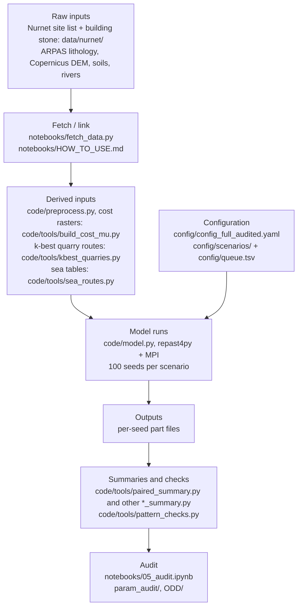

# Nuraghe construction: an agentic agent-based model

**Background.** This model is an implementation of the agentic agent-based modelling framework proposed by Altaweel and Forte (2026).

Reference: Altaweel, M. and Forte, M. (2026). Archeological theory and AI: the potential past through agentic systems. AI & Society. https://doi.org/10.1007/s00146-026-03287-0

An agent-based model (ABM) built to test archaeological ideas about **how nuraghi were built**: who quarried,
dressed, hauled and lifted the stone, how communities cooperated, formed alliances or relied on pre-existing
networks, and what each idea implies for labour and time. Bronze Age Sardinia (7,167 nuraghe sites) is the test
case; the method is the subject. Each community is an agent that plans its towers stage by stage, asks other
communities for help, learns from its own building and from trust built by reciprocity, and moves stone along
least-cost routes over the real terrain (and, in some scenarios, by sea). Literature-based scenarios set the
labour rates, block sizes, haul techniques, lifting methods, population and season length; every parameter is
traced to its source or labelled as an assumption (`param_audit/`).

The model is written in Python on **repast4py** (Collier, N. and Ozik, J. 2022. Distributed agent-based
simulation with Repast4Py. *Proceedings of the 2022 Winter Simulation Conference (WSC)*.
doi:[10.1109/WSC57314.2022.10015389](https://doi.org/10.1109/WSC57314.2022.10015389)) and MPI.

## How it works

- **Agents.** One community agent per nuraghe (7,167), with its residents, its work party and the towers it has to
  build (`code/alliance.py`; ODD section 2).
- **A season** (one tick: 90 working days of 8 hours, standing for one year). Each community works on its current
  tower as a chain of stage tasks: quarrying, dressing, hauling the blocks on sledges along least-cost routes from
  the chosen quarry face, and building (including lifting) (ODD sections 2-3).
- **Cooperation.** Communities ask others within 10 km for help (up to 3 requests); a request is accepted according
  to trust, which reciprocity raises or lowers. Each community learns which choices worked for it, imitates
  successful neighbours, and gains skill with experience (ODD sections 3-4). The 10 km help radius is the headline
  value; a sensitivity runs it at 5 and 15 km on the headline (`MOST_REALISTIC_AUDITED_LIT_R5_P10` /
  `_R15_P10`, `config/scenarios/config_R5_audited.yaml` / `config_R15_audited.yaml`, ODD Appendix B).
- **Quarry face choice and the near-site rule.** Each site has up to 5 candidate quarry faces (the k-best
  least-cost routes); at each tower it picks one by epsilon-greedy learning (exploration with epsilon = 0.1,
  otherwise the face with the best learned value) or by imitating a cheaper neighbour. A site whose dry-ground route
  to its nearest (cheapest) face is at most 1,000 m (config key `quarry.near_site_fixed_face_m`; absent or 0 = off)
  always quarries from that face, with no exploration, value choice or imitation of the face; sites farther away keep
  the choice among their faces (ODD section 7.6; `code/METHODS.md`).
- **Minimum haul.** `transport.min_haul_flatm` is 15 m: the haul of a site that sits on its outcrop, and the floor of
  every whole route (drag and walk back; relay legs have no minimum). The sea tables apply it and are rebuilt per
  config (ODD section 7.5; `code/METHODS.md`).
- **Stone, loading and rules behind flags.** The on-outcrop test uses the stone set a site actually quarries, and a
  site's stone is the class of the face it hauls from. Four rules sit behind flags in a top-level `add4:` config
  block: `bedrock_everywhere` (every site quarries at the bedrock rate) and `load_per_tonne` (loading per tonne) are
  on, `rails_cost_choice` and `sea_priced_as_charged` off. A stage with no work creates no help request, walk, trust
  change or skill credit, and in join mode each party is priced at its own skill (ODD sections 7.1-7.7;
  `code/METHODS.md`).
- **Lift and learning.** Lift, by every lift rule, is priced at the undiscounted rate: the learning factor
  (1 - 0.15)^t and skill apply to quarrying, dressing and building only (ODD sections 7.7, 7.9, 7.12; test
  `code/tests/test_lift.py`).
- **The code and configuration of the model.** `code/` is the code of the model (SHA-256 of every file in
  `CODE_SHA256SUMS`); `config/config_full_audited.yaml` is its configuration (the same values as
  `config/scenarios/config_full_audited.yaml`, the copy the queue reads, and as `code/config.yaml`). The run
  signature includes the code version string `CODE_VERSION` (`code/lit.py`) and the `add4` settings. The results in
  the paper come from this code and configuration; the remaining sensitivity results land with the final pass
  ([Sensitivity results](#sensitivity-results)). The ODD describes this code.
- **Phasing.** In the headline scenario the island is built in cohorts of 10% of the communities, one cohort after
  the other (`_P10`; ODD section 7).
- **What is measured.** Man-hours per site and stage, start and finish of every tower; per seed, island man-hours
  and island years (the time until the last tower is finished), over 100 seeds per scenario; the summary also gives
  the island-wide 95th percentile of site finish seasons and the spread across seeds (ODD section 4.11).
- **Optional social switches.** Three opt-in mechanisms (`reputation`, `partner_choice`, `tie_imitation`), a rule key `reputation_rule` (`all`, the default, or `gentle`: only defectors' and ungrateful refusals cost standing) and a switch `trusted_nodist` (no distance penalty in the acceptance of help between reciprocal partners, after Kasper & Borgerhoff Mulder 2015, Fig. 2) are off by default and in the headline; only the social scenarios use them (`config/scenarios/config_social_*.yaml`; ODD sections 7.15-7.16). With them off the outputs and run signatures are unchanged (ODD 7.15).
- **Parameters.** No parameter is calibrated: every value has an audited source (author, year, page) or is
  declared an assumption (`param_audit/`).

## Workflow



## Start here

| Model description | Replicate the results |
|---|---|
| [ODD/ODD.md](ODD/ODD.md) (PDF: [ODD/ODD.pdf](ODD/ODD.pdf)): the ODD protocol of the model | [notebooks/](notebooks/): start with [notebooks/HOW_TO_USE.md](notebooks/HOW_TO_USE.md), then run `01_setup`, `02_inputs`, `03_scenarios`, `04_analysis_report`, `05_audit`, `06_sensitivity` in order, in Jupyter or Google Colab (the model's code `code/` and configuration, read from `config/scenarios/config_full_audited.yaml`) |

Parameter audit and traceability: [param_audit/](param_audit/) (below).

### Replicate the results: quick start in Colab

1. Open [notebooks/README.md](notebooks/README.md) and use the "Open in Colab" links, 01 to 06 in order.
2. In the config cell of each notebook set `MOUNT_DRIVE = True` and the same Google Drive folders for `DATA_DIR`,
   `DERIVED_DIR` and `OUTPUTS_DIR` (each Colab notebook runs in its own runtime; values in
   [HOW_TO_USE.md](notebooks/HOW_TO_USE.md#run-in-google-colab)).
3. Run all cells. 01 installs OpenMPI and the pinned packages; 02 copies the Nurnet files from `data/nurnet/`,
   downloads every public input from its official source (`notebooks/fetch_data.py`) and gets the derived inputs;
   03 and 04 run and analyse scenarios; 05 is the step-by-step audit (code checksums, inputs, configuration, a fixed
   rerun, the headline numbers), each step with its expected result; 06 runs the sensitivity steps (A5 grid, Morris,
   Sobol) at demo size. The full-size sensitivity results are in `outputs/sensitivity/`, and the Sobol harnesses in
   `sensitivity/` (see [Sensitivity results](#sensitivity-results)).

The Nurnet files (site list and per-site building stone) are included in `data/nurnet/`; for the latest version and
source information contact Nurnet at nurnet.presidente@gmail.com.

### Data availability

- **Nurnet's data** (7,167 nuraghe sites with tower counts; building stone per site): included in this repository,
  `data/nurnet/` (`data/nurnet/README.txt`). For the latest version and source information contact Nurnet at
  nurnet.presidente@gmail.com.
- **Public layers** (ARPAS lithology, Copernicus DEM GLO-30, AGRIS soil map, RAS rivers): not redistributed here;
  `notebooks/fetch_data.py` downloads them from the official sources and rebuilds the files the model reads, and
  `notebooks/HOW_TO_USE.md` gives the same steps by hand. Each file is checked against the SHA-256 of the copy used
  for the runs (`notebooks/inputs_manifest.csv`); the files that cannot be byte-identical, and why, are listed there
  and in `data/README.md`.
- **Derived inputs** (haul tables, quarry routes, sea tables, ...): rebuilt from the raw inputs by
  `python notebooks/fetch_data.py --rebuild-derived` (about 30-45 min), or the prebuilt pack of the full audited run
  in the results package (DOI pending).
- **Results** of the full audited run (per-seed tables, part files, logs): results package, DOI pending.

## Sensitivity results

The sensitivity results of the model (code `code/`, configuration `config/scenarios/config_full_audited.yaml`)
are in [`outputs/sensitivity/`](outputs/sensitivity/), as small island-level tables (no per-site data). It is the only
folder of the repository with model results. Each subfolder has a README with the factors, ranges, commands and dates.

| folder | what | status |
|---|---|---|
| `a5_alliance/` | alliance-model grid on `A5_full`: 27 cells (radius x learning ratio x track cost) + the `A0_alone` reference, 100 seeds each | complete |
| `sobol2/` | Sobol run 2 on the headline: 26 factors, Saltelli N = 512 (14,336 evaluations x 3 seeds) | design now; results with the final pass |
| `coop_sobol/` | cooperation-model Sobol: 11 factors x scenarios none / mixed / full, N = 512 (19,968 evaluations) | design now; results with the final pass |
| `morris/` | Morris screens (32-factor screen; physical 5-factor screen) | with the final pass |
| `feasibility/` | feasibility grid (pull x drag x tonnage) | with the final pass |

**Reading the tables.** All are CSV (`*.csv.gz`: gzip-compressed; `pandas.read_csv` reads both).

- *Inputs:* `design.csv(.gz)` (one row per evaluation: `eval_id`, `base_row`, `block` = the Saltelli block A, AB_<factor>
  or B, the uniform sample `u_<factor>` and the factor values), `factors.csv` (name, config key, distribution,
  range, reason), `problem.json` (the SALib problem and the sampling settings).
- *Per-run tables:* `runs.csv.gz` (`sobol2`) has one row per model run (evaluation x seed); `per_eval.csv.gz` one row per
  evaluation (the mean of its seeds for `sobol2`; one seed for `coop_sobol`), with `status` and the outputs (for
  example `island_years`, `island_mh` = island man-hours, `mh_transport_share`; `island_total_mh`, `island_days_max`
  and `median_site_total_mh_TWR1..7` = median over the sites with 1-7 towers). `a5_alliance/` has its own
  `cells.csv`, `island_by_seed.csv` and `sensitivity.csv` (described in its README).
- *Index tables* (`indices.csv`, and `indices_N256.csv` on the first half of the design as a convergence check):
  one row per (`scenario`,) `output` and `factor`; `N` = base rows used; `S1` = first-order index (the share of the
  output's variance due to the factor alone); `ST` = total-order index (alone and in interaction with the others);
  `S1_conf` / `ST_conf` = half-width of the 95% bootstrap confidence interval (1,000 resamples), `*_lo` / `*_hi` =
  the interval's ends. Morris tables give `mu_star` (mean absolute elementary effect) with its 95% interval.
- `MANIFEST.csv`: every exported file with its size, number of rows, SHA-256 and source run; check a file with
  `sha256sum FILE` against the `sha256` column.

**Regenerating them.** The Sobol harnesses are in [`sensitivity/`](sensitivity/) (the scripts that ran, with the
code variant of Sobol run 2 as a patch on `code/`; commands, runtime and memory in each README). They write the
run tables and indices into their own folder; `python outputs/sensitivity/export.py --project <folder>` turns them
into the tables above (it recomputes the indices with SALib 1.6.0 and checks them against the run's own analysis).
The A5 grid runs from `code/` (`outputs/sensitivity/a5_alliance/README.md`); `notebooks/06_sensitivity.ipynb` runs
every design at demo size.

## Repository layout

```
code/            the model and its tools
  model.py         entry point (baseline, cooperation, literature, alliance and pre-network scenarios)
  alliance.py      adaptive alliances / MOST_REALISTIC; lit.py, sea.py, phasing.py, pre_networks.py, census_scenarios.py
  preprocess.py    haul tables (least-cost quarry -> site); nbcommon.py config loader + Dijkstra
  config.yaml      default configuration (the values of config/config_full_audited.yaml, relative paths)
  tools/ tests/    derived-input builders, post hoc analyses, unit tests and verification scripts
  run_queue.sh     runs the queue config/queue.tsv, one entry at a time (Run the queue, below)
  METHODS.md       methods of the model (rules, equations, parameters)
config/          config_full_audited.yaml (the model's configuration), scenarios/ (one configuration per scenario
                 variant of the queue: the same values plus the variant's changes), queue.tsv (every run of the model),
                 sea_expect/ + check_sea_meta.py (expected sea-table parameters of the variants with their own sea tables)
data/            data/nurnet/ (Nurnet's data, included); the other inputs are fetched (data/README.md; data/derived/README.md)
notebooks/       01-06: setup, inputs (fetch_data.py), scenarios, analysis, audit, sensitivity; HOW_TO_USE.md; Jupyter or Colab
param_audit/     parameter audit and traceability (public-safe copies)
sensitivity/     harnesses of the Sobol runs (sobol2/, coop_sobol/; see Sensitivity results)
tools_extra/     build_slope.py, build_dem.py, build_lithology.py, build_rivers.py (input builders)
outputs/         everything a run writes (NOT committed, except sensitivity/ (the sensitivity results) and reference/ and
                 summary/ for the audit)
ODD/             ODD protocol of the model (ODD.md, ODD.pdf)
CODE_SHA256SUMS  SHA-256 of every file of code/ (`cd code && sha256sum -c ../CODE_SHA256SUMS`)
```

## Requirements / Installation

Linux or macOS (Windows: WSL2 with Ubuntu), Python 3.12 or later for exact (byte-identical) reproduction, because from 3.12 Python's built-in float `sum()` uses compensated summation and the model sums floats with it; the tested environment is Python 3.13.5.
On Python 3.10-3.11 the model runs and results agree except for last-digit differences.

| what | version (minimum in `code/requirements.txt`; tested in `notebooks/requirements-colab.txt`) |
|---|---|
| MPI with compiler wrappers | OpenMPI or MPICH. Ubuntu / Debian / Colab: `sudo apt-get install -y openmpi-bin libopenmpi-dev`; macOS: `brew install open-mpi`; conda: `conda install -c conda-forge openmpi mpi4py` |
| repast4py | >= 1.1.6; tested 1.3.1 (Collier & Ozik 2022, above; install guide https://repast.github.io/repast4py.site/) |
| mpi4py | >= 3.1; tested 4.1.2 |
| numpy / numba / pandas | >= 1.24 / >= 0.58 / >= 2.0; tested 2.5.4 / 0.68.0 / 3.0.6 |
| geopandas / pyogrio / rasterio | >= 0.14 / >= 0.7 / >= 1.3; tested 1.2.0 / 0.13.0 / 1.5.2 (the wheels include GDAL, tested 3.12.2; no system GDAL needed) |
| pyyaml | >= 6.0; tested 6.0.3 |
| also pinned for the tools and notebooks | scipy 1.18.1, shapely 2.2.0, pyproj 3.8.0, matplotlib 3.11.2, networkx 3.7, reportlab 5.1.0, SALib 1.6.0 and dependencies (35 pins) |

1. Install MPI (above).
2. Install the Python packages; repast4py and mpi4py compile against MPI:
   ```
   CC=mpicc CXX=mpicxx python -m pip install -r notebooks/requirements-colab.txt     # exact tested versions
   CC=mpicxx CXX=mpicxx python -m pip install -r code/requirements.txt              # or: minimum versions
   ```
   `torch` is not pinned: repast4py imports it, the model never uses it.
3. Get the input data: `python notebooks/fetch_data.py` (or by hand: `notebooks/HOW_TO_USE.md`); set `data_dir:` in
   the config you use to the **absolute** path of the data folder (the configs in `config/` hold a placeholder).

Resources (measured on the 8 GB machine of the runs): one 100-seed run of the headline scenario on 6 MPI ranks takes
about 6 minutes and peaks at about 6 GB (proportional set size 5.9 GB; resident 7.6 GB; largest rank 2.8 GB); the
derived-input rebuild peaks at about 2.5 GB (one process at a time). Disk: about 0.5 GB of raw inputs, 0.75 GB of
derived inputs, about 0.25 GB of part files per 100-seed scenario.

`code/run_queue.sh` (the queue) also needs `flock` and Linux cgroup v2 (it reads
`/sys/fs/cgroup/memory.events` to stop on an out-of-memory kill).

Environment variables used by the scripts (only where a path was hard-wired in the project):

| Variable | Meaning |
|---|---|
| `PYTHON` | the Python interpreter of the environment above (shell scripts; default `python3`) |
| `NURAGHE_RUN_DIR` | the run folder of `code/run_queue.sh` (below) |
| `NURAGHE_TEST_CONFIG` | the configuration read by the unit tests (`code/tests/test_*.py`, below) |
| `NURAGHE_PROJECT` | the project folder, for some post hoc tools that read the project's run folders (paths written into them); not needed for the model itself |
| `NURAGHE_DATA` | the data folder, for `tools/pattern_checks.py` (default `data`) |

## Rebuild the derived inputs

The model reads cached derived inputs (haul tables, k-best quarry routes, sea tables, food catchments, drag-cost
rasters per friction). Download them from the results package or rebuild them with the commands in
`data/derived/README.md` (in order: cost and slope rasters, `preprocess.py`, haul tables per friction,
`tools/kbest_quarries.py`, `tools/kbest_mu038.py`, `tools/wl_inputs.py`, `tools/sea_routes.py`,
`tools/food_capacity.py`, `tools/census_bichrome.py`); `python notebooks/fetch_data.py --rebuild-derived` runs them
all in order (about 30-45 min with the hybrid stone rule, peak about 2.5 GB).

The stone rule of the full audited configuration is `hybrid`: the recorded building stone of each site where it is
known, else the nearest outcrop of the 7 permitted classes. That per-site file is **Nurnet's data (site building
stone)**, included as `data/nurnet/nurnet_site_building_stone.csv` (`fetch_data.py` copies it to
`stone/nid_materiale_prod.csv` under the data folder). `stone_rule: stones7` ignores it (results then differ).

## Run one scenario

From `code/`, with a configuration whose `data_dir` and `cache_dir` point at the inputs:

```
cd code
mpirun -n 6 $PYTHON model.py /path/to/run/config_full_audited.yaml --seeds 1-100 --no-shapefile \
       --alliance MOST_REALISTIC_AUDITED_LIT_P10
```

`MOST_REALISTIC_AUDITED_LIT_P10` is the headline scenario of the full audited run (6 ranks; about 6 min and up to
~8 GB on the machine that ran it). Other families: `--scenario NAME` (cooperation), `--lit NAME` (literature),
`--alliance NAME` (alliances, MOST_REALISTIC and its variants), `--pre NAME` (pre-existing networks); no flag =
baseline. `--sites UID1,UID2,...` (e.g. the contents of `code/sites300_real.txt`) runs a subset. Runs are resumable:
finished seeds are kept as part files under `cache_dir/runs/<signature>/` (the signature hashes every parameter and
the site list) and skipped on restart. Field meanings and the model rules: `code/METHODS.md`. The notebooks
(`notebooks/`) wrap the same commands.

## Tests

The unit tests (`code/tests/test_*.py`: Dijkstra, the `add4` flags, the fixes of the stage, join and stone rules, the
run signature, the lift rule; fake models, no simulation) read one configuration, `NURAGHE_TEST_CONFIG`: the model's
configuration with `data_dir` and `cache_dir` set (for example `WORK_DIR/config.yaml`, written by
`notebooks/02_inputs.ipynb`). `test_D11_tables` reads the prepared tables of that cache.

```
cd code
NURAGHE_TEST_CONFIG=/path/to/config.yaml python -m pytest -q tests/     # or: python tests/test_lift.py (etc.)
```

`tests/verify_*.py` and `tests/test_reproducibility.py` check whole runs (commands in their docstrings).

## Run the queue

The results of the model come from `config/queue.tsv` (432 entries, seeds 1-100 each, one entry at a time), each on
its configuration in `config/scenarios/`, run with `code/`. `code/run_queue.sh` runs it serially and is resumable (a
finished entry leaves `outputs/logs/q_<label>.ok`). It expects a run folder laid out as below:

```
REPO=/path/to/Repast_Nuraghe; RUN=/path/to/run; DATA=/path/to/data; PYTHON=/path/to/python
mkdir -p $RUN/configs $RUN/outputs/logs $RUN/outputs/caches && ln -s $REPO/code $RUN/code
cp $REPO/config/scenarios/*.yaml $RUN/configs/ && sed -i "s|^data_dir: .*|data_dir: $DATA|" $RUN/configs/*.yaml
sed -e "s|@RUN_DIR@|$RUN|g" -e "s|@PYTHON@|$PYTHON|g" $REPO/config/queue.tsv > $RUN/queue.tsv
# prepared tables: see below
cd $RUN && NURAGHE_RUN_DIR=$RUN PYTHON=$PYTHON nohup bash code/run_queue.sh > outputs/logs/chain.out 2>&1 &
```

**Prepared tables.** Each configuration reads its own cache, `outputs/caches/<config name>/` (`cache_dir`), with its
own `runs/` folder (part files; the run signature keeps scenarios apart). Fill them before starting the queue:

1. Base cache `outputs/caches/config_full_audited/`: download or rebuild it with `configs/config_full_audited.yaml`
   (`data/derived/README.md`), including its sea tables (`python code/tools/sea_routes.py
   configs/config_full_audited.yaml`).
2. Every other configuration: link every entry of the base cache except `runs/` into its own cache folder, and give it
   an empty `runs/`. The header of each file in `config/scenarios/` says whether it needs more:
   - "its own sea tables" (the variants that change hauling, crew, blocks, loading or the sea; 35 files): `sea/` must
     be an empty real folder; build it with `python code/tools/sea_routes.py configs/<config>` (`--speeds 0.67` for
     `config_full_audited_alt_sea067.yaml`) and, where `config/sea_expect/<config name>.json` exists, copy that file to
     the cache as `sea_expect.json` and check the build with `python config/check_sea_meta.py <cache>`;
   - `config_full_audited_alt_stones7.yaml` also has its own haul tables and k-best routes (`alliance/`, `haul/` and
     the base haul tables not linked): `python code/preprocess.py configs/<config>`, the same with `--tag mu0.38` and
     `--tag mu0.1` and the matching `--cost-raster <cache>/cost_mu/drag_cost_8dir_mu<MU>_int.tif`, then
     `code/tools/kbest_quarries.py`, `kbest_mu038.py` and `wl_inputs.py` on the configuration.

The model's on-outcrop test (`preprocess.py`) reads the stone set a site quarries, so a base cache built with code
other than `code/` can differ; rebuild it with `code/`. The run signature includes `CODE_VERSION` and the effective
`add4` settings, so no part file of a different code version is reused. The queue was estimated at about 34 hours of
wall time on the 8 GB machine of the runs (6-8 ranks per entry, `ranks` column).

## Parameter audit and traceability

- `param_audit/PARAM_AUDIT.md` (+ `PARAM_AUDIT_ADDENDUM.md`): every parameter that acts on the headline scenario
  and every behaviour of the model, with value, role, source (author, year, page) or assumption label, evidence
  status before and after the audit, and the action taken. The audited values form `AUDITED_LIT`, the parameter set
  of `config_full_audited.yaml`.
- `param_audit/TRACEABILITY.md`, `PARAM_TRACE.csv`: each audited parameter -> config key -> code line -> queued
  scenarios that vary it.
- `param_audit/IDEA_TRACE.csv`, `census.csv`: the census of construction ideas from the literature (author, year,
  page, evidence type, testability, the scenario that implements each idea, and a field prediction). Quotations
  are not reproduced; see the cited works.
- Results, per-scenario tables, logs and the derived inputs of the full audited run: results package
  "data file/nuraghe-build-abm-full-audited" (Nurnet cloud), DOI pending. Files referred to in the audit documents
  but not in this repository (e.g. `SCENARIO_PROVENANCE_v2.csv`, `GAPS.md`, `PARAM_NOT_IN_AUDIT.csv`,
  `LIT_ALT_COVERAGE.csv`) are in that package.

## Data credits

Nuraghe sites: Nurnet's data — a Nurnet merge and deduplication of various sources; included in `data/nurnet/`.
Building stone per site: Nurnet's data; included in `data/nurnet/`. For the latest version and source information
contact Nurnet at nurnet.presidente@gmail.com. Lithology: ARPAS 2019, Carta Litologica della
Sardegna 1:25,000, © Regione Autonoma della Sardegna / ARPAS, CC BY 4.0. DEM: Copernicus DEM, © DLR e.V.
2010-2014 and © Airbus Defence and Space GmbH 2014-2018, provided under COPERNICUS by the European Union and ESA.
Soils: Aru, Baldaccini & Vacca 1991, RAS/AGRIS, CC BY. Rivers: Regione Autonoma della Sardegna, PPR 2006 layer
'Fiumi torrenti e altri corsi d'acqua' ('fiumitorrenti'), see provider. Details and links: `data/README.md`.

## Version

This repository holds one version of the model: the code in `code/` and the configurations in `config/` that
produced the results. Earlier development versions are in the git history.

## Citation

Paper in preparation. Please cite the paper when it is published; until then, cite this repository and the
results package (DOI pending).

## Licence

Licence: to be decided by the authors.
